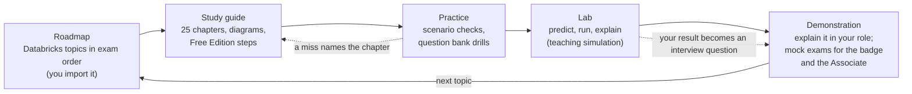

# Databricks in PrepBench: what we have, what's missing, what to build

**Date:** 2026-10-29 (revised the same day: your goal is **solution architecture**, section 1). **Status:** proposal,
waiting for the learner's decisions (section 7). Nothing here is built yet.
**Research behind it:** `docs/research/databricks-documentation-notes.md` (20 sections, every fact from an official
Databricks, Microsoft, Delta Lake or Apache Spark page read on 2026-10-29, plus both current exam guides read in full
and the architect and administrator accreditation pages).

This is written for you, the learner. It says what PrepBench already gives you for Databricks, what it doesn't, and what
I propose to add, in the same way the Kafka track was built (study guide, scenarios, question bank, lab, interview
practice). You don't need to check any technical claim here; the research file cites a source for each one, and the
material built from it will be held to those sources by tests.

---

## 1. The certification question first

### 1a. You're preparing for solution architecture

Databricks has **no "Solutions Architect" certification**. Its certification page lists none; "solutions architect" is
a job title (notes §1.4). Three official things are close, and they suit different goals:

| | **Azure Platform Architect badge** | **Data Engineer Associate** | **Platform Administrator accreditation** |
|---|---|---|---|
| What it tests | "deployment, security and cloud integrations for Azure Databricks" | building pipelines on the platform | running the platform: users, compute, permissions |
| Areas | Platform administration fundamentals · Network configuration · Platform access and security · External storage configuration · Cloud service integrations (**no weights published**) | Seven sections with published weights (table below) | Users and groups · Compute · Governance and security (no weights) |
| Questions / time | 20 / unlimited, not proctored | 45 / 90 min, proctored | 25 / unlimited, not proctored |
| Pass mark | **80% (published)** | Not published | Not published on its page |
| Cost, validity | Free for Databricks customers and partners; 1 year | USD 200; 2 years | Free for customers and partners; 1 year |
| Training it expects | Databricks Academy "Azure Databricks Data + AI Platform Architect Pathway" | 6 months hands-on | Academy "Platform Administration With Databricks" |

**My recommendation for a solution architect on Azure: both the Azure Platform Architect badge and the Data Engineer
Associate, as one track.** An architect has to answer two kinds of question: *how is the platform set up safely on
Azure* (networking, identity, storage access, workspaces: the badge) and *what do the pipelines on it do* (Delta, Unity
Catalog, ingestion, jobs, cost: the Associate). The badge is small (20 questions) but covers what the Associate leaves
out almost entirely: VNet injection, secure cluster connectivity, Private Link, serverless network connectivity,
storage firewalls. The Associate gives the badge's "external storage" and "access and security" areas their depth.

Two cautions:

- The badge is "free for Databricks customers and partners", registered through Databricks Academy. The page doesn't say
  whether others can take it. Check on Academy that your account can register before relying on it.
- The badge publishes no weights and I couldn't read the Academy training (it needs a sign-in), so a bank for it is
  sized evenly across its five areas and says so. It never claims to mirror the real 20 questions.

"Solution architecture" is also an **interview** skill: whiteboarding a platform design and defending its trade-offs.
PrepBench's scenarios and Say-it questions cover that (section 3). Today's scenarios have lenses for PO, PM, delivery
manager and engineering manager; adding a **solution architect** lens is decision 5 in section 7.

### 1b. The two data engineering exams

Databricks has two data engineering exams. Both were revised this year.

| | **Data Engineer Associate** | **Data Engineer Professional** |
|---|---|---|
| Guide date | Exam published 4 May 2026; guide updated 6 Aug 2026 | Exam and guide 9 Oct 2026 |
| Questions / time | 45 scored multiple-choice (+ up to 10 unscored) / 90 min | 60 scored multiple-choice (+ unscored) / 120 min |
| Fee, validity | USD 200; 2 years | USD 200; 2 years |
| Recommended experience | 6 months hands-on | 1 year hands-on |
| Sections (weight) | Platform 6% · Ingestion and loading 21% · Transformation and modelling 22% · Lakeflow Jobs 16% · CI/CD 10% · Troubleshooting, monitoring, optimisation 10% · Governance and security 15% | Python and SQL code 23% · Ingestion 12% · Data manipulation 12% · Monitoring and alerting 10% · Cost and performance 15% · Security and compliance 8% · Governance 5% · Debugging and deploying 10% · Data modelling 5% |
| Pass mark | **Not published** | **Not published** |

**Of these two, the Associate** (and it is the half of the architect track above). Databricks describes it as covering "introductory data engineering
tasks", it asks for six months of experience, and its sections (Delta Lake, Unity Catalog, ingestion, jobs, governance,
cost of compute) are exactly what a PO, PM, delivery manager or cloud engineering manager on a Databricks/Azure
platform has to speak about with confidence. The Professional is a sensible second step later; it goes deep into
streaming state, UDFs, testing, system tables and performance tuning. Databricks also offers free "Databricks
Fundamentals" training with a badge, but it is not a certification exam.

Things worth knowing before you choose:

- Neither exam publishes a pass mark. PrepBench will show "No pass mark set" rather than invent one (third-party sites
  claim 70% for the Associate; nothing official says so).
- The Professional exam's web page and its guide disagree (59 vs 60 questions, ten vs nine sections). The guide is newer,
  so anything built for the Professional would follow the guide.
- The Associate guide asks about "GRANT, REVOKE, and DENY" in Unity Catalog. The current documentation has no `DENY`
  statement in Unity Catalog SQL (it exists in the old Hive metastore model, and as a Beta "ABAC DENY policy"). The
  material will teach what the documentation says and point out the difference, so the exam wording doesn't trip you.
- Databricks renamed a lot in 2025-26 (Delta Live Tables → Lakeflow Spark Declarative Pipelines; Databricks Asset
  Bundles → Declarative Automation Bundles; Delta Sharing → OpenSharing). The exam uses the new names; older courses and
  your ChatGPT-era notes may use the old ones. The guide gives both.

## 2. What PrepBench has for Databricks today

- **A "Databricks Data Platform" preparation** (slug `databricks`), a **skill** with no certification and no questions.
- **The ADLS Gen2 study guide** (pack `adls`, 11 chapters) is attached to it. Useful background (storage, ACLs, how Spark
  reaches the lake), but not Databricks itself.
- **A roadmap:** the preparation owns roadmap 3, the "Storage FileSystems to Cloud Mastery Roadmap" (13 phases, 63
  topics). It is about storage and cloud in general; there is **no Databricks roadmap**.
- **The Lakehouse Lab** (`/databricks-sandbox`), six stations over a fictional semiconductor migration:
  - **A** — ADF + Lakeflow Jobs as a step list (simulation): watermark ordering, what a pipeline run does.
  - **B** — ADLS landing zone (simulation): where batches land and who can touch them.
  - **C** — Delta Lake, "the load that went wrong", on a **real Delta engine**: create, schema enforcement failure, schema
    evolution, MERGE of a CDC batch, history, time travel, restore, compaction (with optional Z-order), vacuum, and a
    table comparison that catches value drift row counts miss.
  - **D** — Reconciliation Detective: find planted defects between legacy and migrated tables.
  - **F** — Migration Factory: planning and cutting over migration waves (programme management).
  - **I** — Identity and governance: Kerberos/Entra trust paths and turning Ranger policies into Unity Catalog grants or
    ABAC (simulation).
- **Interview practice from the lab:** each station can turn your own results into an interview question (P1-1), and
  AI feedback on acceptance criteria (P1-6).
- **Not present:** a Databricks study guide, Databricks scenarios, a certification preparation, a question bank, a
  Databricks roadmap, diagrams of Databricks mechanisms.

## 3. The gaps, item by item

| Item | PrepBench today | Missing | Proposal |
|---|---|---|---|
| **Roadmap** | Roadmap 3 "Storage FileSystems to Cloud Mastery" (generic storage/cloud) | Any Databricks roadmap; topics in the exam's order | A **Databricks roadmap workbook** (`.xlsx`, the same 4-tab format as your Kafka and ADF roadmaps) with about 40-45 topics in 7 phases that follow the Associate's sections, each topic mapped to a guide chapter. **You import it** on the Roadmaps screen and assign it to the Databricks skill; nothing is loaded from code. Roadmap 3 stays where it is unless you unlink it. |
| **Study guide** | ADLS guide only | Databricks itself | Pack **`databricks`** v1: about **20 chapters** written as Markdown and built into the pack like the Kafka guide, covering every Associate objective (list in section 4). Every fact cites the research notes; a test fails on an uncited section, a table not last in its section, or a deprecated name used as current. **Hands-on steps for Databricks Free Edition** in each chapter where Free Edition can do it (notebooks, Unity Catalog objects and grants, Delta operations, Auto Loader with `availableNow`, `COPY INTO`, a declarative pipeline with expectations, a multi-task job, a SQL warehouse). What Free Edition can't do (classic clusters, pools, policies, spot instances, account-level identity, Azure storage credentials) is taught from the docs and marked "read, not run". |
| **Diagrams** | None for Databricks | Pictures of the key mechanisms | Redrawn, theme-aware, Large-text-safe figures (inline SVG or Mermaid, per `docs/wiki/Importing-Content.md`): the **Delta transaction log** (versions, add/remove, snapshot, what VACUUM deletes), the **medallion flow**, the **Unity Catalog hierarchy and privilege inheritance**, **managed vs external** tables on DROP, **Auto Loader + checkpoint** (offsets, commits, state, RocksDB file tracking), **streaming table vs materialized view**, a **Lakeflow Job DAG** with Run-if conditions and repair, **control plane vs compute plane on Azure**, **shuffle, skew and salting**; for the architect track, **the three network connections** (users, classic compute, serverless), **VNet injection with its two subnets and the SCC relay**, **the three kinds of Private Link with the transit and workspace VNets**, and **serverless → storage through an NCC or a network security perimeter**. |
| **Scenarios with Say-it questions** | None for Databricks | Written cases in your roles' voice | Pack **`databricks`** v2 adds **18 written scenarios** in four levels, in the Kafka/ADF format (check questions, case study, debrief, takeaway, honesty note, and a **lens plus a Say-it question for each of PO, PM, delivery manager and engineering manager**). Examples: the vacuum that broke a regulator's time-travel query; the MERGE that failed on duplicate source keys; Auto Loader stopping on a new column; a full refresh that wiped a streaming table's history; a job repair that loaded a batch twice; the external table whose files survived DROP; the skewed join AQE did fix and the skewed `groupBy` it didn't; the all-purpose cluster bill for nightly jobs; the grant that worked for the table owner but not for analysts (missing `USE SCHEMA`). Your saved answers become interview questions, as with ADF and Kafka. |
| **Certification question bank** | None (0 questions) | A bank to the exam's weights | A bundled bank you import on the Question Bank screen, built from one source file per section (as CCDAK). **300 questions** sized by the Associate's weights: Platform 18 · Ingestion 63 · Transformation 66 · Jobs 48 · CI/CD 30 · Troubleshooting 30 · Governance 45. The CCDAK tests reused from day one: import validator clean, at least four options, a cited source on every question, section counts, right answers spread across positions, the right answer rarely the longest option (checked per section from the first draft), an out-of-scope list, and SQL used for code where possible (as the exam does). Built in parts with a **delta file** for each part after the first, so an earlier import isn't duplicated. Nothing about a pass mark. **For the architect badge, a second, smaller bank: 100 questions, 20 per area** (even split, because no weights are published, and labelled so), multiple choice and multiple select like the badge, in its own certification preparation with the published **80%** pass mark and 20-question mocks. |
| **Lab** | Stations A, B, C, D, F, I (see section 2) | Exam topics no station touches | See section 5. In short: keep the stations; add **six beginner experiments** on the shared lab runner (the Kafka Lab pattern): the Delta log and retention; Auto Loader and checkpoints; streaming tables vs materialized views; a job DAG with Run-if, retries, timeout and repair; shuffle, skew and AQE; Unity Catalog privileges and managed/external tables. All teaching simulations, labelled so, graded only from your own runs. |
| **Interview material** | Station-generated questions; the shared interview library | Databricks questions in your roles | From the scenarios (72 Say-it questions: 18 × 4 roles), the lab experiments (one question per experiment from your own run, as Kafka Lab does), and a short **"explain it to a stakeholder"** prompt at the end of each guide chapter. No AI grading without a configured provider ("Not Graded" otherwise). |

## 4. What the study guide would cover (draft chapter list)

Ordered as you'd learn it, each chapter tagged with the Associate section(s) it serves.

1. What the lakehouse is, and where Databricks sits on Azure (control plane, compute plane, account, workspace, metastore) — §1
2. Delta Lake: Parquet plus a transaction log — §1, §7
3. Versions, history, time travel, RESTORE, VACUUM and retention — §1, §6
4. Schemas: enforcement and evolution — §2, §3
5. MERGE, deduplication and change data feed — §3
6. Data layout: liquid clustering, Z-order, data skipping, deletion vectors, predictive optimization — §6
7. Unity Catalog: catalogs, schemas, tables, volumes, the metastore — §1, §7
8. Managed and external tables, external locations, Azure storage credentials (Access Connector) — §7
9. Privileges and inheritance; row filters, column masks, ABAC, dynamic views; lineage — §7
10. Compute and cost: serverless, classic, job vs all-purpose, SQL warehouses, policies, pools, DBUs — §1
11. Spark essentials for the exam: DataFrames, joins, unions, explode, dedup, aggregates — §3
12. Cleaning bronze into silver; the medallion architecture; gold objects (views, MVs, streaming tables) — §3
13. Ingestion choices: Lakeflow Connect, `COPY INTO`, Auto Loader, JDBC/REST — §2
14. Auto Loader in depth: file detection, schema inference, rescued data, evolution modes — §2
15. Structured Streaming: checkpoints, triggers, watermarks, output modes, `foreachBatch` — §2, §3
16. Lakeflow Spark Declarative Pipelines: streaming tables, materialized views, expectations, AUTO CDC, refreshes — §3, §4
17. Lakeflow Jobs: tasks, DAG, Run-if, If/else, For each, retries, timeouts, triggers, repair — §4, §6
18. Performance: AQE, broadcast, shuffle partitions, skew, spill, the Spark UI, the disk cache — §3, §6
19. Monitoring: job run history, pipeline event log, system tables, cost attribution — §6
20. CI/CD: Git folders, Declarative Automation Bundles, the Databricks CLI, secrets — §5
21. Databricks with ADF and ADLS: who orchestrates what, passing parameters, migration lessons (links to your ADF and ADLS guides) — background, badge "cloud service integrations"

For the architect track, four more chapters (badge areas in brackets; Azure only, taught from the docs as "read, not
run", because Free Edition has no VNet, Private Link or account console):

22. Account, workspaces and metastores on Azure: serverless vs hybrid workspaces, who can create one, SCIM, account vs
    workspace admins, system tables and audit logs for the platform owner — [platform administration fundamentals]
23. Classic compute networking: VNet injection (two subnets, sizing, delegation, managed NSG rules), secure cluster
    connectivity, NAT gateway egress and the March 2026 change, peering, UDRs, on-premises — [network configuration]
24. Private connectivity: the three kinds of Private Link, transit and workspace VNets, the browser-auth workspace, NCCs
    and serverless private endpoints, IP access lists — [network configuration; platform access and security]
25. Reaching storage safely: Access Connector and managed identity, storage credentials and external locations,
    storage firewalls for classic and serverless (network security perimeter, service tags) — [external storage
    configuration] (builds on chapter 8)

## 5. The lab: what the stations teach versus the exam

| Associate section | Covered by an existing station | Not covered | Proposed experiment |
|---|---|---|---|
| 1 Platform (6%) | C (Delta basics) | Compute choice and cost | Folded into experiment 6's cost note; mostly guide + scenarios |
| 2 Ingestion (21%) | A (pipeline run order, watermark), B (landing) | Auto Loader, checkpoints, schema evolution modes, `COPY INTO` idempotency | **E2 Auto Loader and checkpoints**: drop files, predict what a run ingests, add a column, see `addNewColumns` stop and restart, `rescue` keep going; replay a file and see it skipped; delete the checkpoint and see everything re-read |
| 3 Transformation (22%) | C (MERGE, enforcement, evolution), D (data quality by reconciliation) | Streaming table vs MV, expectations, union/join traps, skew | **E3 Streaming table vs materialized view**: change the query, update a dimension, full refresh; **E5 Shuffle, skew and AQE**: a hot key in a join vs a `groupBy`, broadcast threshold, salting |
| 4 Jobs (16%) | A (a step list) | Run-if conditions, retries, timeout, triggers, repair duplicates | **E4 Job DAG**: build a 4-task DAG, set Run-if, retries and a timeout, fail a task, repair, and watch an append-only task duplicate rows |
| 5 CI/CD (10%) | — | Bundles, targets, variables | Guide + scenarios only (a simulated deploy adds little) |
| 6 Troubleshooting (10%) | C (compaction, Z-order) | Liquid clustering, predictive optimization, spill/skew diagnosis | E5 above; **E1 Delta log and retention** includes liquid clustering vs Z-order as a layout choice |
| 7 Governance (15%) | I (Ranger → Unity Catalog grants/ABAC) | `USE CATALOG`/`USE SCHEMA`/`SELECT` chain, inheritance to future tables, managed vs external on DROP | **E6 Unity Catalog privileges**: grant at catalog/schema/table, predict who can read; drop a managed vs an external table and see what happens to the files |
| (all) | — | How the log makes time travel and VACUUM work | **E1 Delta log and retention**: commits as JSON versions, add/remove files, time travel, VACUUM with 7-day vs shorter retention, RESTORE seen by a downstream stream as new data |

For the architect badge, one more: **E7 Network path tracer** (teaching simulation). Pick a workspace's setup (VNet
injection or not, SCC on or off, which Private Link kinds, public access on or off, an NCC or not, a storage firewall)
and predict, for each of three journeys (a user opening the workspace, a classic cluster reaching the control plane, a
serverless job reading ADLS), whether it goes public or private, which endpoint it uses, and whether it is blocked. The
picture draws the VNets, subnets, endpoints and paths. Every rule comes from notes §20; the 403 from a storage account
that only allow-listed serverless subnet IDs is one of its cases.

Rules these follow (from the existing Lakehouse Lab and the Kafka Lab contract): pure models, a picture of the state, a
predict-before-you-see step, graded only from your own run, every fact coupling citing the research notes and its guide
chapter, and every screen saying it is a **teaching simulation, not a Databricks workspace**. Station C's real Delta
engine stays the place where Delta operations run for real; whether it can also show liquid clustering is a question to
check in the engine before promising it.

**Open choice for later (not needed now):** these six could live as new Lakehouse Lab experiments under
`/databricks-sandbox`, or as their own "Databricks Lab" at `/lab/databricks` on the shared runner like the Kafka Lab. I
lean to the shared runner (it is the newer, tested pattern) with links from the Lakehouse Lab hub.

## 6. The learning journey

Same rule as everywhere else in PrepBench: practice and lab runs change a topic's recommended next step and name each
miss, but only a demonstration completes a topic; readiness for the exam comes only from full mock exams.

## 7. Decisions I need from you

1. **Which credentials?** For solution architecture my recommendation is the **Azure Platform Architect badge plus the
   Data Engineer Associate** (section 1a). Alternatives: the badge alone (smallest; 20 questions on deployment and
   networking only), or the Associate alone (the original plan, no networking).
2. **Their own preparations?** I recommend **yes**, as CCDAK is separate from the Kafka skill: an "Azure Databricks
   Platform Architect" certification preparation (20-question mocks, 80% pass mark as published) and a "Databricks Data
   Engineer Associate" one (45 questions, 90 minutes, no pass mark set), each holding its bank and mocks, while the
   **Databricks skill** keeps the study guide, scenarios, lab and roadmap (packs attach only to skills, the settled D1).
   You would create them on the Preparations screen.
3. **Order of building** (one PR each). My proposal, architect-first:
   1. Roadmap workbook (small; gives the guide its topic map, both credentials' topics)
   2. Study guide v1: 25 chapters with diagrams and Free Edition steps
   3. Architect bank (100 questions, 20 per area)
   4. Scenarios (pack v2) with Say-it questions, including platform-design cases (a private workspace whose SSO broke
      when the browser-auth workspace was deleted; serverless jobs getting 403 from a firewalled storage account; a
      subnet sized too small for the cluster plan)
   5. Associate bank, part 1 (Ingestion, Transformation, Governance — 174 questions)
   6. Associate bank, part 2 (Platform, Jobs, CI/CD, Troubleshooting — 126, with a delta file)
   7. Lab experiments, E7 (network paths) first
4. **Roadmap 3** ("Storage FileSystems to Cloud Mastery") stays on the Databricks skill unless you choose to unlink it.
   That's your action on the Roadmaps screen; I won't change it from code.
5. **A solution architect lens on the scenarios?** Today every scenario has four lenses (PO, PM, delivery manager,
   engineering manager). Adding a fifth, architect, for the Databricks scenarios means changing the scenario format the
   ADF and Kafka packs share, so it is your call. Without it, the architect angle lives in the case and the debrief.

Once you've answered, I'll start with the first piece in the order you pick.
