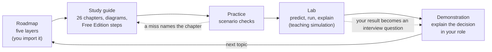

# Databricks in PrepBench: what we have, what's missing, what to build

**Date:** 2026-10-29, revised twice the same day. **Your goal, in your words:** a deep understanding of Databricks, to
**lead a Databricks migration project**. Databricks has no "Solutions Architect" certification, so this is a **skill
track, not a certification**: no exam preparation, no question bank, no mock exams. **Status:** proposal, waiting for
your build order (section 7). Nothing here is built yet.
**Research behind it:** `docs/research/databricks-documentation-notes.md` (21 sections; every fact from an official
Databricks, Microsoft, Delta Lake or Apache Spark page read on 2026-10-29, as page text, not summaries).

This is written for you, the learner. You don't need to check any technical claim here: the research file cites a
source for each one, and the material built from it will be held to those sources by tests.

---

## 1. What "leading a migration with thorough understanding" needs

A migration lead doesn't have to write every notebook, but has to be right about the things that decide scope, cost,
risk and sequence, and has to hold their own with engineers, architects and security. From the documentation, that is
five layers:

| Layer | What you must be able to explain and decide | Notes |
|---|---|---|
| **1. The platform** | Control plane vs compute plane; account, workspace, metastore; serverless vs classic compute and what each costs; Delta Lake's log, history, `VACUUM`, layout | §2, §12, §17 |
| **2. Governance** | Unity Catalog's hierarchy, managed vs external tables, privileges and inheritance, row filters and masks, lineage, audit | §6, §14, §15 |
| **3. Workloads** | Ingestion (Auto Loader, `COPY INTO`, Lakeflow Connect), streaming, declarative pipelines, Jobs, Spark performance | §7-§11 |
| **4. The Azure landing zone** | VNet injection, secure cluster connectivity, Private Link, serverless connectivity, storage access through the Access Connector, ADF's role | §17, §20 |
| **5. The migration itself** | What changes for warehouse, Hive, SQL and Spark code; how data moves (clone, convert, Auto Loader); how metadata moves (UCX, upgrade wizard, `SYNC`, deep clone, Hive metastore federation, fallback mode); code conversion (Genie Migrate); proving results match | §21 |

The two exam outlines researched earlier (Data Engineer Associate and Professional, §1) stay useful as a **checklist of
breadth**: the guide covers every Associate objective so nothing basic is missing, but nothing is built to sit an exam.
The Azure Platform Architect badge's areas (§1.4) are covered by layer 4 for the same reason.

## 2. What PrepBench has for Databricks today

- **A "Databricks Data Platform" preparation** (slug `databricks`), already a **skill**. Everything below attaches to it;
  no new preparation is needed.
- **The ADLS Gen2 study guide** (pack `adls`, 11 chapters) is attached to it: storage, ACLs, how Spark reaches the lake.
- **A roadmap:** roadmap 3, "Storage FileSystems to Cloud Mastery" (13 phases, 63 topics), about storage and cloud in
  general. There is **no Databricks roadmap**.
- **The Lakehouse Lab** (`/databricks-sandbox`), six stations over a fictional semiconductor migration:
  - **A**: ADF + Lakeflow Jobs as a step list (simulation).
  - **B**: ADLS landing zone (simulation).
  - **C**: Delta Lake on a **real Delta engine**: create, schema enforcement, evolution, MERGE, history, time travel,
    restore, compaction, Z-order, vacuum, table comparison.
  - **D**: Reconciliation Detective: find planted defects between legacy and migrated tables.
  - **F**: Migration Factory: planning and cutting over migration waves (the programme side).
  - **I**: Identity and governance: Ranger policies to Unity Catalog grants or ABAC (simulation).
- **Interview practice from the lab** (P1-1) and AI feedback on acceptance criteria (P1-6).
- **Not present:** a Databricks study guide, Databricks scenarios, a Databricks roadmap, diagrams of Databricks
  mechanisms, and anything on the platform side of migration (Hive metastore to Unity Catalog, Parquet to Delta, code
  conversion, the Azure network landing zone).

## 3. The gaps, item by item

| Item | PrepBench today | Missing | Proposal |
|---|---|---|---|
| **Roadmap** | Roadmap 3 (generic storage/cloud) | A Databricks roadmap | A **Databricks roadmap workbook** (`.xlsx`, the same 4-tab format as your Kafka and ADF roadmaps), about 45-50 topics in the five layers of section 1, each mapped to a guide chapter. **You import it** and assign it to the Databricks skill; nothing is loaded from code. Roadmap 3 stays unless you unlink it. |
| **Study guide** | ADLS guide only | Databricks itself, and migration | Pack **`databricks`** v1: **26 chapters** (section 4), written as Markdown and built into the pack like the Kafka guide. Every fact cites the research notes; a test fails on an uncited section or a deprecated name used as current. **Hands-on steps for Databricks Free Edition** where it can do it (Delta, Unity Catalog grants, Auto Loader, `COPY INTO`, pipelines, jobs; whether `CONVERT TO DELTA` and `CLONE` of Parquet run there is checked in Free Edition's documented limits before a step promises it); what it can't (VNets, Private Link, account console, Hive metastore, UCX) is taught from the docs and marked "read, not run". Each chapter ends with **"What this means for the migration"**: the decision it informs and the question to ask the team. |
| **Diagrams** | None for Databricks | Pictures of the mechanisms | Theme-aware, Large-text-safe figures (inline SVG or Mermaid): Delta log; medallion flow; Unity Catalog hierarchy and inheritance; managed vs external on `DROP`; Auto Loader + checkpoint; streaming table vs materialized view; Job DAG with Run-if and repair; control vs compute plane on Azure; the three network connections; VNet injection with the SCC relay; Private Link kinds; **Hive metastore → Unity Catalog paths** (UCX, wizard/`SYNC`, deep clone, federation with fallback mode); **Parquet → Delta methods**; **a migration wave from assess to decommission**. |
| **Scenarios with Say-it questions** | None for Databricks | Written cases | Pack v2 adds **18 scenarios** in four levels in the Kafka/ADF format (checks, case, debrief, takeaway, honesty note, a lens and Say-it question per role). **Weighted to migration**, for example: deep-cloned tables lost their time travel and an auditor asked for last quarter's version; `CONVERT TO DELTA` ran while a legacy job still wrote Parquet and `VACUUM` later deleted the untracked files; a federated `DROP SCHEMA ... CASCADE` dropped the Hive tables too; fallback mode left on months after cut-over; converted T-SQL that ran but returned different totals; over-partitioned tables carried over from Hive; serverless jobs getting 403 from a firewalled storage account; a `MERGE` failing on duplicate source keys; a job repair that loaded a batch twice; the nightly all-purpose cluster bill. Your saved answers become interview questions, as with ADF and Kafka. |
| **Lab** | Stations A, B, C, D, F, I | Migration mechanics and core platform behaviour | Section 5: seven experiments on the shared lab runner (the Kafka Lab pattern), two of them migration-specific. All teaching simulations, labelled so, graded only from your own runs. |
| **Interview material** | Station-generated questions; the shared library | Databricks and migration questions in your roles | From the scenarios (72 Say-it questions), the lab (one per experiment from your own run), and each chapter's "What this means for the migration" prompt. No AI grading without a configured provider ("Not Graded" otherwise). |
| **Question bank** | None | Not needed | **Dropped**: there is no certification to prepare for. Scenario checks and lab predictions are the practice. (If you ever want the Associate exam, the research and the bank plan are in the notes, §1.2.) |

## 4. The study guide (draft chapter list)

Ordered as you'd learn it; the layer from section 1 in brackets.

**Part 1: the platform** [1]
1. What the lakehouse is, and where Databricks sits on Azure (control plane, compute plane, account, workspace, metastore)
2. Delta Lake: Parquet plus a transaction log
3. Versions, history, time travel, `RESTORE`, `VACUUM` and retention
4. Schemas: enforcement and evolution
5. `MERGE`, deduplication and change data feed
6. Data layout: liquid clustering, Z-order, data skipping, deletion vectors, predictive optimization
7. Compute and cost: serverless, classic, job vs all-purpose, SQL warehouses, policies, pools, DBUs

**Part 2: governance** [2]
8. Unity Catalog: catalogs, schemas, tables, volumes, the metastore
9. Managed and external tables, external locations, storage credentials (Access Connector)
10. Privileges and inheritance; row filters, column masks, ABAC; lineage and audit

**Part 3: workloads** [3]
11. Spark essentials: DataFrames, joins, unions, aggregates, deduplication
12. The medallion architecture: bronze, silver, gold
13. Ingestion choices: Lakeflow Connect, `COPY INTO`, Auto Loader
14. Auto Loader and Structured Streaming: checkpoints, triggers, watermarks, schema evolution
15. Lakeflow Spark Declarative Pipelines: streaming tables, materialized views, expectations, AUTO CDC
16. Lakeflow Jobs: tasks, Run-if, retries, timeouts, triggers, repair
17. Performance: AQE, shuffle, skew, broadcast, spill, the Spark UI
18. Monitoring and cost: system tables, event logs, cost attribution
19. CI/CD: Git folders, Declarative Automation Bundles, the CLI, secrets

**Part 4: the Azure landing zone** [4]
20. Workspaces and the account: serverless vs hybrid workspaces, who can create one, SCIM, admins
21. Network: VNet injection, secure cluster connectivity, NAT egress, Private Link, serverless connectivity (NCCs)
22. Databricks with ADF and ADLS: who orchestrates what, parameters, storage firewalls (links to your ADF and ADLS guides)

**Part 5: the migration** [5]
23. What changes when you move to Databricks: warehouse semantics (table-level transactions, informational keys), Hive
    workloads, SQL and dbt, existing Spark code
24. Moving data: deep and shallow `CLONE`, `CONVERT TO DELTA` and its `VACUUM` trap, Auto Loader backfills, repartitioning
25. Moving metadata and permissions: Hive metastore to Unity Catalog with UCX, the upgrade wizard, `SYNC`, deep clone,
    Hive metastore federation and fallback mode; disabling Hive access at the end
26. Converting and proving code: Genie Migrate, custom conversion rules, comparing old and new results (links to the
    Lakehouse Lab's Station D reconciliation and Station F waves)

## 5. The lab: what the stations teach, and seven experiments to add

| Layer | Existing station | Proposed experiment |
|---|---|---|
| 1 Platform | C (Delta on a real engine) | **E1 Delta log and retention**: commits as JSON versions, time travel, `VACUUM` at 7 days vs shorter, `RESTORE` |
| 2 Governance | I (Ranger → Unity Catalog) | **E2 Unity Catalog privileges**: grant at catalog/schema/table, predict who can read; drop managed vs external |
| 3 Workloads | A, B | **E3 Auto Loader and checkpoints**; **E4 Streaming table vs materialized view**; **E5 Job DAG and repair** |
| 4 Azure | — | **E6 Network path tracer**: choose VNet injection, SCC, Private Link kinds, public access, an NCC, a storage firewall; predict whether each journey (user, classic cluster, serverless job) is public, private or blocked |
| 5 Migration | D (reconciliation), F (waves) | **E7 Hive → Unity Catalog upgrade planner**: a small Hive estate (managed tables in workspace storage, external Parquet, a shared directory, a Hive-only SerDe); pick a path per table (UCX, `SYNC`, deep clone, federation, `CONVERT TO DELTA`) and predict the result: managed or external, history kept or lost, which other tables break, what fallback mode allows, what `DROP` would do |

Rules (from the Lakehouse Lab and the Kafka Lab contract): pure models, a picture of the state, predict before you see,
graded only from your own run, every fact coupling citing the notes and its guide chapter, every screen saying it is a
**teaching simulation, not a Databricks workspace**. Station C's real Delta engine stays where Delta operations run for
real. The earlier draft's shuffle/skew experiment is left out to keep scope at seven; performance is taught in
chapter 17 and the scenarios.

**Open choice for later:** these could be new Lakehouse Lab experiments under `/databricks-sandbox` or a "Databricks
Lab" at `/lab/databricks` on the shared runner like the Kafka Lab. I lean to the shared runner, linked from the
Lakehouse Lab hub.

## 6. The learning journey

As everywhere in PrepBench: practice and lab runs change a topic's recommended next step and name each miss, but only a
demonstration completes a topic. A skill track's Home is led by its roadmap, never by mocks.

## 7. Decisions I need from you

Settled by you on 2026-10-29: **no certification; Databricks stays a skill**, aimed at leading a migration.

1. **Build order** (one PR each). My proposal:
   1. Roadmap workbook (small; gives the guide its topic map)
   2. Study guide v1: all 26 chapters with diagrams. If you'd rather start using it sooner, I can ship **Part 5
      (migration) and Part 1 (platform) first** as v1 and add Parts 2-4 as v2.
   3. Scenarios (the next pack version), migration-weighted
   4. Lab experiments, E7 (migration planner) and E6 (network) first
2. **Roadmap 3** stays on the Databricks skill unless you unlink it on the Roadmaps screen; I won't change it from code.
3. **A fifth lens on the scenarios?** Today each has PO, PM, delivery manager and engineering manager lenses, which
   already fit a migration lead. Adding "solution architect" changes the format the ADF and Kafka packs share; I suggest
   **not** adding it, and putting the architecture reasoning in each case and debrief instead.
